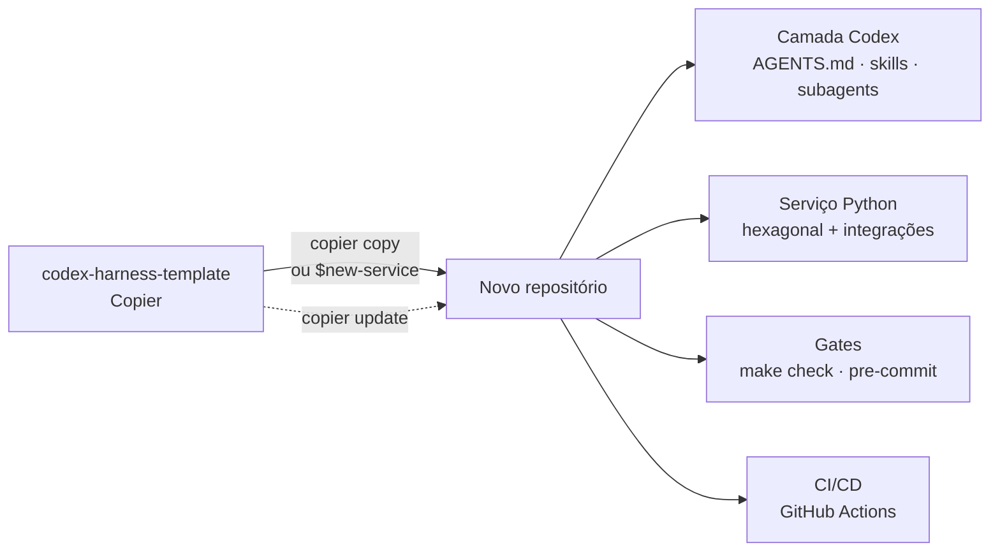
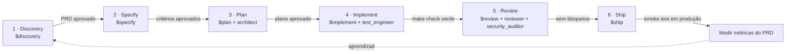
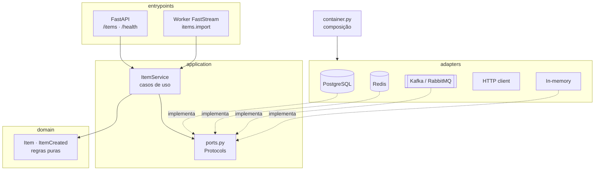
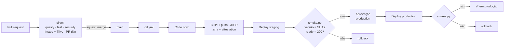

# codex-harness-template

> Ways of working de engenharia de software com **Python** e **OpenAI Codex**: um template que gera
> repositórios prontos para construir serviços robustos, do *discovery* do produto até o código
> verificado em produção.

---

## Sumário

- [O problema que resolve](#o-problema-que-resolve)
- [Como funciona](#como-funciona)
- [Início rápido](#início-rápido)
- [O SDLC agêntico](#o-sdlc-agêntico)
- [A camada Codex](#a-camada-codex)
- [O serviço gerado](#o-serviço-gerado)
- [Qualidade e segurança](#qualidade-e-segurança)
- [CI/CD: do merge à produção verificada](#cicd-do-merge-à-produção-verificada)
- [Configuração pós-geração](#configuração-pós-geração)
- [Estrutura deste repositório](#estrutura-deste-repositório)
- [Desenvolvendo o template](#desenvolvendo-o-template)
- [Decisões e princípios](#decisões-e-princípios)

---

## O problema que resolve

Agentes de código aceleram a escrita de código, mas sem processo eles também aceleram dívida
técnica: código sem especificação, sem testes que provem os requisitos, sem verificação de
segurança e sem garantia de que o que foi escrito chegou em produção.

Este projeto define **como** humanos e agentes trabalham juntos e entrega isso pronto para uso:

- **Processo**: seis fases (Discovery → Specify → Plan → Implement → Review → Ship). Cada uma tem
  um artefato versionado no repositório e um gate de aprovação.
- **Agentes**: instruções (`AGENTS.md`), skills por fase e subagents especializados para o Codex.
- **Engenharia**: um serviço Python de referência com arquitetura hexagonal, integrações reais
  (banco, cache, eventos, APIs) e testes em todos os níveis.
- **Guardrails automáticos**: lint, tipos, arquitetura, auditoria de dependências, segredos e
  scan de imagem, aplicados localmente, no pre-commit e no CI.
- **Entrega contínua**: cada merge chega em produção, e um smoke test prova que a versão certa
  está no ar.

Princípio central: **não reinventar a roda**. Tudo é feito com ferramentas consolidadas do
ecossistema (uv, Ruff, mypy, pytest, FastAPI, SQLAlchemy, FastStream, Copier, GitHub Actions);
o template apenas as integra de forma enxuta.

## Como funciona



1. Você responde algumas perguntas: nome, versão do Python, Postgres?, Redis?, Kafka/RabbitMQ?
2. O [Copier](https://copier.readthedocs.io) renderiza um repositório com **somente** o que você
   escolheu (sem código morto de integrações não usadas).
3. O projeto gerado já passa no próprio gate (`make check`) e está pronto para o primeiro
   `$discovery`.
4. Quando o template evoluir, `copier update` traz as melhorias para os projetos existentes.

## Início rápido

**Pré-requisitos:** [uv](https://docs.astral.sh/uv/), Docker, `make`, Git e, opcionalmente,
o [Codex CLI](https://developers.openai.com/codex).

### Opção 1 — Copier (interativo)

```bash
uvx copier copy gh:spassos/codex-harness-template meu-servico
cd meu-servico
make setup   # instala dependências e git hooks
make check   # lint, tipos, arquitetura, auditoria, testes (com Docker) e cobertura
make up      # sobe app + infraestrutura → http://localhost:8000/docs
```

### Opção 2 — Copier (não interativo)

```bash
uvx copier copy --defaults gh:spassos/codex-harness-template meu-servico \
  -d project_name="Orders Service" \
  -d use_postgres=true -d use_redis=true -d event_broker=kafka
```

### Opção 3 — Agente de scaffolding no Codex

Clone este repositório, abra o `codex` nele e peça:

```text
$new-service crie um serviço de pedidos com Postgres e Kafka
```

A skill [`new-service`](.agents/skills/new-service/SKILL.md) faz a entrevista, renderiza o
template, roda `make check` no resultado, faz o commit inicial e sugere começar o `$discovery`.

### Perguntas do template

| Pergunta | Padrão | Efeito |
|---|---|---|
| `project_name` | — | Nome do produto/serviço |
| `project_slug` | derivado | Nome do repositório/imagem (kebab-case) |
| `package_name` | derivado | Pacote Python (snake_case) |
| `description` | derivado | Descrição curta |
| `author_name` | `Platform Team` | Time responsável |
| `python_version` | `3.13` | 3.12, 3.13 ou 3.14 |
| `use_postgres` | `true` | Repositório SQL, Alembic, testes com Postgres real |
| `use_redis` | `true` | Cache-aside com Redis |
| `event_broker` | `kafka` | `kafka`, `rabbit` ou `none` (publisher + worker consumidor) |
| `coverage_threshold` | `90` | Cobertura mínima exigida pelo gate |

Sem integrações, o serviço usa adapters em memória: o mesmo código roda sem nenhuma
infraestrutura.

## O SDLC agêntico



| Fase | Quem lidera | Artefato | Gate |
|---|---|---|---|
| **1. Discovery** | Produto + Codex | `docs/product/<slug>.md` (PRD: problema, usuários, métricas, escopo, integrações, riscos) | Problema e métricas aprovados |
| **2. Specify** | Produto/Tech Lead + Codex | `docs/specs/NNN-<slug>/spec.md` (critérios de aceite Given/When/Then, contratos HTTP/eventos/dados, requisitos não funcionais) | Critérios testáveis aprovados |
| **3. Plan** | Tech Lead + `architect` | `plan.md` (desenho por camada, modos de falha, AC → teste, tarefas pequenas) + ADRs | Plano aprovado |
| **4. Implement** | Dev + Codex | Código + testes, uma tarefa por vez, em TDD | `make check` verde, cada AC com teste |
| **5. Review** | `reviewer` + `security_auditor` + humano | Achados priorizados | Nenhum achado bloqueante |
| **6. Ship** | CI/CD | PR → CI → staging → produção | Smoke test confirma a versão em produção |

Regra de ouro: **sem spec aprovada, não há código**. Um pedido vago começa em `$specify`, nunca
em `$implement`. O projeto gerado inclui uma spec de referência (`docs/specs/001-items`) que
mostra o formato completo, com cada critério de aceite mapeado para o teste que o prova.

Exemplo de sessão:

```text
codex
> $discovery lojistas precisam importar o catálogo via eventos
> $specify docs/product/importacao-catalogo.md, fatia 1
> $plan docs/specs/002-importacao-catalogo/spec.md
> $implement docs/specs/002-importacao-catalogo/plan.md
> $review
> $ship
```

## A camada Codex

Todos os arquivos usam os formatos oficiais do Codex: `AGENTS.md`, skills em `.agents/skills/`,
configuração de projeto em `.codex/config.toml` e subagents em `.codex/agents/*.toml`.

| Arquivo | Para que serve |
|---|---|
| `AGENTS.md` | Comandos, fases do SDLC, regras de arquitetura, convenções e guardrails, lidos pelo agente em toda tarefa |
| `.codex/config.toml` | `approval_policy = on-request`, sandbox `workspace-write`, rede liberada para o uv, limites de subagents |
| `.agents/skills/discovery` | Entrevista e escreve o PRD (template em `assets/`) |
| `.agents/skills/specify` | Spec com critérios de aceite e contratos |
| `.agents/skills/plan` | Plano técnico, tarefas e ADRs |
| `.agents/skills/implement` | Loop TDD (red → green → refactor → `make check` → commit) |
| `.agents/skills/integrate` | Receitas para nova tabela/migração, cache, publicar/consumir eventos, API externa |
| `.agents/skills/review` | Checklist de revisão, executada com dois subagents em paralelo |
| `.agents/skills/ship` | PR, CI, merge, CD, verificação em produção e rollback |
| `.codex/agents/architect.toml` | Desenho e ADRs (somente leitura) |
| `.codex/agents/test_engineer.toml` | Escreve testes que falham a partir dos critérios de aceite |
| `.codex/agents/reviewer.toml` | Revisão independente contra spec e convenções (somente leitura) |
| `.codex/agents/security_auditor.toml` | OWASP API Top 10, supply chain, segredos, CI e container (somente leitura) |
| `.github/workflows/codex-review.yml` | Review automático de PR com `openai/codex-action` (opcional) |

## O serviço gerado

### Arquitetura hexagonal



- `domain/` e `application/` não importam frameworks. O **import-linter** quebra o build se
  alguém importar `fastapi`, `sqlalchemy`, `redis` etc. nessas camadas.
- `container.py` é o único lugar que escolhe adapters. Os testes trocam tudo por fakes em memória.
- O exemplo `Item` exercita todas as integrações. Ele existe para ser substituído pelo seu domínio.

### Integrações (fontes e saídas)

| Integração | Direção | Biblioteca | Testada com |
|---|---|---|---|
| API HTTP | entrada / saída | FastAPI + pydantic | TestClient |
| PostgreSQL | fonte / saída | SQLAlchemy Core async + asyncpg + Alembic | testcontainers |
| Redis | cache (cache-aside) | redis-py asyncio | testcontainers |
| Kafka / RabbitMQ | eventos de entrada (worker) e saída (`items.created`) | FastStream | TestBroker + testcontainers |
| APIs de terceiros | saída | httpx (timeouts) + stamina (retry transitório) | respx |
| Logs | saída | structlog (JSON) + `X-Request-ID` | — |
| Saúde | saída | `/health/live` (versão) e `/health/ready` (dependências) | TestClient + integração |

### Estrutura do projeto gerado

```
meu-servico/
├── AGENTS.md                      # contrato com agentes
├── .codex/                        # config do projeto + subagents
├── .agents/skills/                # skills por fase do SDLC
├── docs/
│   ├── ways-of-working.md         # o processo completo
│   ├── conventions.md             # convenções de código, testes e git
│   ├── product/                   # PRDs
│   ├── specs/NNN-slug/            # spec.md + plan.md
│   └── adr/                       # decisões de arquitetura
├── src/<pacote>/
│   ├── domain/                    # regras de negócio puras
│   ├── application/               # casos de uso + ports
│   ├── adapters/                  # postgres, redis, broker, http, memory
│   ├── entrypoints/               # http/ (FastAPI), worker.py (FastStream)
│   ├── container.py               # composição
│   ├── config.py                  # Settings (APP_*)
│   └── observability.py           # structlog
├── tests/{unit,api,integration}/
├── migrations/                    # Alembic
├── scripts/{smoke.py,deploy.sh}   # verificação pós-deploy e contrato de deploy
├── Makefile                       # interface única para humanos, agentes e CI
├── compose.yaml · Dockerfile
└── .github/                       # CI, CD, release, review Codex, Dependabot, templates
```

### Comandos (`make help`)

| Comando | O que faz |
|---|---|
| `make setup` | Instala dependências e git hooks |
| `make test-unit` | Testes unitários e de API, sem Docker (segundos) |
| `make fmt` | Formata e corrige lint automaticamente |
| `make check` | **Definition of Done**: lint, mypy, arquitetura, auditoria e testes com cobertura |
| `make run` / `make worker` | API com reload / consumidor de eventos |
| `make up` / `make down` | Ambiente completo em Docker |
| `make migration m="..."` / `make migrate` | Cria / aplica migrações |
| `make image` | Build da imagem |
| `make smoke url=... version=...` | Verifica um deploy |

## Qualidade e segurança

| Preocupação | Ferramenta | Onde roda |
|---|---|---|
| PEP 8, PEP 257, bugs comuns, complexidade ≤ 8 | Ruff (lint + format) | pre-commit, `make check`, CI |
| Tipagem | mypy `--strict` | pre-commit, `make check`, CI |
| Arquitetura | import-linter | pre-commit, `make check`, CI |
| Testes e cobertura | pytest, pytest-cov, testcontainers, respx | `make check`, CI |
| Vulnerabilidades em dependências | pip-audit sobre o lockfile completo, Dependabot | `make check`, CI, semanal |
| Código inseguro | Ruff `S` (regras do Bandit) | pre-commit, CI |
| Segredos | gitleaks | pre-commit, CI |
| Segurança dos workflows | zizmor, actions fixadas por SHA, permissões mínimas | CI |
| Imagem | Trivy, base slim, usuário não-root, provenance attestation | CI, CD |
| Revisão | subagents `reviewer` + `security_auditor`, Codex review no PR, humano | `$review`, PR |

O `AGENTS.md` proíbe explicitamente desabilitar testes, regras ou checagens para "ficar verde".

## CI/CD: do merge à produção verificada



- **`ci.yml`**: roda em todo PR e é reutilizado pelo CD, então nada chega em produção sem
  passar pelos mesmos gates.
- **`cd.yml` + `deploy.yml`**: a imagem recebe a versão (`APP_VERSION = SHA do commit`). Depois
  do deploy, `scripts/smoke.py` consulta `/health/live` até ver exatamente esse SHA e exige
  `/health/ready = 200`. Se falhar, executa `scripts/deploy.sh rollback`.
- **`release.yml`**: o release-please gera versionamento semântico e CHANGELOG a partir de
  Conventional Commits.
- **`codex-review.yml`**: review do Codex comentado no PR (opt-in).

## Configuração pós-geração

1. Crie o repositório no GitHub e faça o push.
2. Proteja a `main`: PR obrigatório, checks do CI obrigatórios, squash merge.
3. Crie os **Environments** `staging` e `production` (production com *required reviewers*). Em
   cada um, defina a variável `APP_URL` e o segredo `KUBECONFIG_DATA` (kubeconfig em base64).
   Os jobs de deploy ficam desligados até `APP_URL` existir.
4. Plataforma diferente de Kubernetes? Adapte as funções `deploy` e `rollback` de
   `scripts/deploy.sh` (ECS, Cloud Run, Fly.io...), mantendo o contrato.
5. Opcional: segredo `OPENAI_API_KEY` e variável `CODEX_REVIEW=true` para o review automático.
6. No Codex, marque o projeto como confiável para carregar `.codex/config.toml` e os subagents.

## Estrutura deste repositório

```
codex-harness-template/
├── copier.yml                     # perguntas do template
├── template/                      # tudo que é renderizado no novo projeto
├── .agents/skills/new-service/    # agente de scaffolding ($new-service)
├── tests/test_template.py         # renderiza 4 cenários e valida
├── .github/workflows/template-ci.yml
├── AGENTS.md                      # regras para quem (humano ou agente) mantém o template
└── pyproject.toml                 # ferramentas de desenvolvimento do template
```

Arquivos `*.jinja` são renderizados. Arquivos e pastas condicionais usam nomes como
`postgres.py.jinja`, e o arquivo some quando a opção está
desligada.

## Desenvolvendo o template

```bash
uv sync
uv run pytest            # renderiza 4 cenários e valida a estrutura (segundos)
uv run pytest -m slow    # + `make check` completo dentro de cada projeto gerado (precisa de Docker)
```

| Cenário | Postgres | Redis | Broker |
|---|---|---|---|
| `full-kafka` | ✅ | ✅ | Kafka |
| `minimal` | — | — | — |
| `postgres-rabbit` | ✅ | — | RabbitMQ |
| `redis-only` | — | ✅ | — |

O CI do template (`template-ci.yml`) roda a mesma matriz. Toda nova opção no `copier.yml` exige
um novo cenário. Leia o [`AGENTS.md`](AGENTS.md) antes de alterar o template.

## Decisões e princípios

- **Enxuto**: só o que foi escolhido é gerado; Makefile como interface única; nenhuma
  infraestrutura caseira.
- **Clean code verificável**: complexidade limitada, tipos estritos e camadas checadas por
  ferramenta, não por boa vontade.
- **Spec-driven**: critérios de aceite são o contrato entre produto, agente e testes.
- **Humano no controle**: agentes produzem, humanos aprovam em cada gate.
- **Produção é a definição de pronto**: "feito" significa que o smoke test confirmou a versão em
  produção.

As decisões técnicas do serviço gerado estão em `template/docs/adr/`, e o processo completo em
[`template/docs/ways-of-working.md`](template/docs/ways-of-working.md).
