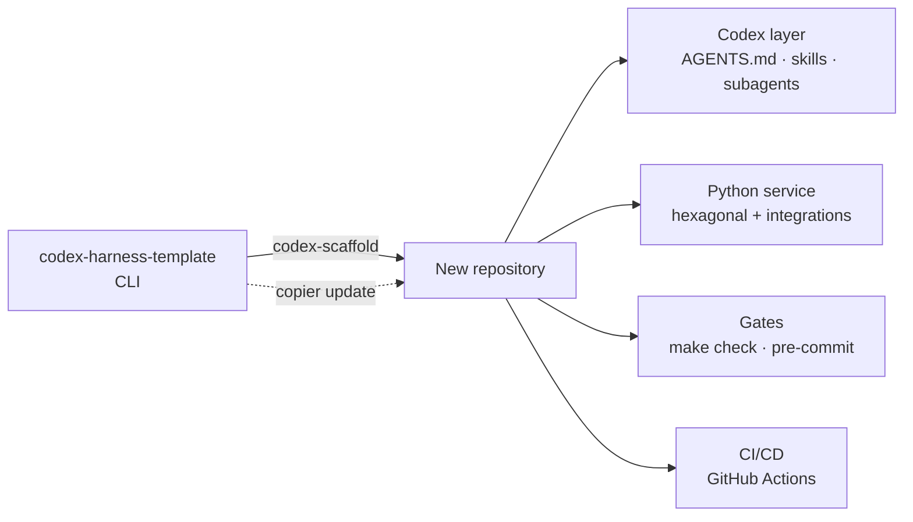
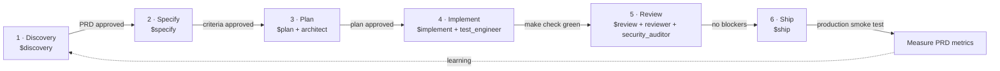
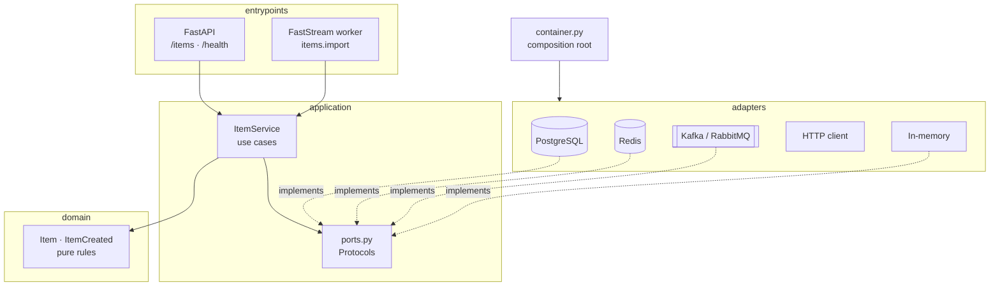
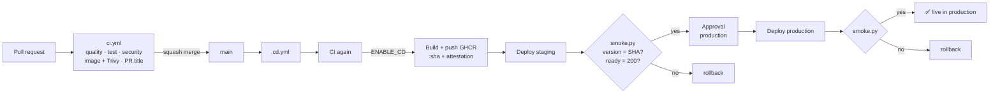

# codex-harness-template

Generate a Python service repository with the **`codex-scaffold` CLI**, then open it in Codex.
The generated repository includes a working FastAPI app, tests, project skills, specialized
agents, conventions and example specs. Add team MCP endpoints when the project needs them.

Install [uv](https://docs.astral.sh/uv/) and Git. From the directory that should contain your new repository, run:

```bash
uvx --from 'git+https://github.com/spassos/codex-harness-template.git@main' codex-scaffold orders-api
cd orders-api
codex
```

---

## Contents

- [The problem it solves](#the-problem-it-solves)
- [How it works](#how-it-works)
- [Quick start](#quick-start)
- [The agentic SDLC](#the-agentic-sdlc)
- [The Codex layer](#the-codex-layer)
- [The generated service](#the-generated-service)
- [Quality and security](#quality-and-security)
- [CI/CD: from merge to verified production](#cicd-from-merge-to-verified-production)
- [Post-generation setup](#post-generation-setup)
- [Repository layout](#repository-layout)
- [Developing the template](#developing-the-template)
- [Principles](#principles)

---

## The problem it solves

Coding agents speed up writing code, but without a process they also speed up technical debt:
code with no specification, no tests proving the requirements, no security checks, and no
guarantee that what was written actually reached production.

This project defines **how** humans and agents work together, and ships it ready to use:

- **Process**: six phases (Discovery → Specify → Plan → Implement → Review → Ship). Each one has
  a versioned artifact in the repository and an approval gate.
- **Agents**: instructions (`AGENTS.md`), one skill per phase and specialized subagents for Codex.
- **Engineering**: a reference Python service with hexagonal architecture, real integrations
  (database, cache, events, APIs) and tests at every level.
- **Automated guardrails**: lint, types, architecture, dependency audit, secrets and image
  scanning, enforced locally, in pre-commit and in CI.
- **Continuous delivery**: teams can enable staging and production deployment with smoke checks for version and readiness.

Core principle: **don't reinvent the wheel**. Everything is built on established tools from the
ecosystem (uv, Ruff, mypy, pytest, FastAPI, SQLAlchemy, FastStream, Copier, GitHub Actions); the
template only wires them together, leanly.

## How it works



1. Give the CLI a destination and select the integrations your service needs.
2. [Copier](https://copier.readthedocs.io) renders a repository with **only** what you chose
   (no dead code for integrations you don't use).
3. The generated project already passes its own gate (`make check`) and is ready for the first
   `$discovery`.
4. When the template evolves, `copier update` brings the improvements to existing projects.

## Quick start

Open the generated directory in Codex and trust the project to load its configuration. Start with
`$discovery` for a new product idea or `$implement` for a well-defined local fix. From another
terminal in the generated directory, use `make run` to start the default API and `make test-unit`
to run its unit and API tests. Developing the service requires make. Docker is needed for external
integration profiles.

For repeated use, install the command once:

```bash
uv tool install 'git+https://github.com/spassos/codex-harness-template.git@main'
codex-scaffold --help
codex-scaffold inventory --name "Inventory Service" --postgres --redis --broker rabbit
```

The CLI initializes Git and locks the generated dependencies with uv. By default it fetches the
template from this repository's `main` branch. Use `--ref` to select a revision, or `--template`
for a local checkout. Choose a new directory. Its name determines the project slug and Python
package. The generated `.copier-answers.yml` records the template source and revision for updates.

For a service that needs an MCP server, pass its HTTPS endpoint. The option is repeatable:

```bash
codex-scaffold ai-service --mcp openai-docs=https://developers.openai.com/mcp
```

Configure any credentials through Codex for the selected server. The default profile runs with
in-memory adapters and requires no MCP server. The `$new-service` skill in this checkout can
also invoke the CLI and verify the new service.

### Template settings

| Question | Default | Effect |
|---|---|---|
| `project_name` | — | Product/service name |
| `project_slug` | derived | Repository/image name (kebab-case) |
| `package_name` | derived | Python package (snake_case) |
| `description` | derived | Short description |
| `author_name` | `Platform Team` | Owning team |
| `python_version` | `3.13` | 3.12, 3.13 or 3.14 |
| `use_postgres` | `false` | SQL repository, Alembic, tests against a real Postgres |
| `use_redis` | `false` | Cache-aside with Redis |
| `event_broker` | `none` | `kafka`, `rabbit` or `none` (publisher + consumer worker) |
| `mcp_servers` | `{}` | Project-scoped HTTPS MCP servers selected by the team |
| `coverage_threshold` | `90` | Minimum coverage required by the gate |

With no integrations selected, the service uses in-memory adapters: the same code runs with no
infrastructure at all.

## The agentic SDLC



| Phase | Led by | Artifact | Gate |
|---|---|---|---|
| **1. Discovery** | Product + Codex | `docs/product/<slug>.md` (PRD: problem, users, metrics, scope, integrations, risks) | Problem and metrics approved |
| **2. Specify** | Product/Tech Lead + Codex | `docs/specs/NNN-<slug>/spec.md` (Given/When/Then acceptance criteria, HTTP/event/data contracts, non-functional requirements) | Testable criteria approved |
| **3. Plan** | Tech Lead + `architect` | `plan.md` (design per layer, failure modes, AC → test mapping, small tasks) + ADRs | Plan approved |
| **4. Implement** | Developer + Codex | Code + tests, one task at a time, TDD | `make check` green, every AC has a test |
| **5. Review** | `reviewer` + `security_auditor` + human | Ranked findings | No blocking findings |
| **6. Ship** | CI/CD | Merge with green CI, optional CD | Confirm the version in production when CD runs |

A clearly scoped local fix starts at `$implement`, with a regression test and `make check`.
Changes to public contracts, migrations and architectural decisions require an approved spec and
plan. Start at `$discovery` if the problem or product outcome needs definition. The generated
reference spec (`docs/specs/001-items`) shows how planned changes map acceptance criteria to tests.

Example session:

```text
codex
> $discovery merchants need to import their catalog through events
> $specify docs/product/catalog-import.md, slice 1
> $plan docs/specs/002-catalog-import/spec.md
> $implement docs/specs/002-catalog-import/plan.md
> $review
> $ship
```

## The Codex layer

Every file uses Codex's official formats: `AGENTS.md`, skills in `.agents/skills/`, project
configuration in `.codex/config.toml` and subagents in `.codex/agents/*.toml`.

| File | Purpose |
|---|---|
| `AGENTS.md` | Commands, SDLC phases, architecture rules, conventions and guardrails, read by the agent on every task |
| `.codex/config.toml` | project subagent limits; runtime permissions and reasoning effort are configured by the team |
| `.agents/skills/discovery` | Interviews and writes the PRD (template in `assets/`) |
| `.agents/skills/specify` | Spec with acceptance criteria and contracts |
| `.agents/skills/plan` | Technical plan, tasks and ADRs |
| `.agents/skills/implement` | TDD loop (red → green → refactor → `make check` → commit) |
| `.agents/skills/integrate` | Recipes for a new table/migration, cache, publishing/consuming events, external APIs |
| `.agents/skills/review` | Review checklist, run with two subagents in parallel |
| `.agents/skills/ship` | PR, CI, merge, CD, production verification and rollback |
| `.codex/agents/architect.toml` | Design and ADRs (read-only) |
| `.codex/agents/test_engineer.toml` | Writes failing tests from the acceptance criteria |
| `.codex/agents/reviewer.toml` | Independent review against spec and conventions (read-only) |
| `.codex/agents/security_auditor.toml` | OWASP API Top 10, supply chain, secrets, CI and container (read-only) |
| `.github/workflows/codex-review.yml` | Automated PR review with `openai/codex-action` (opt-in) |

## The generated service

### Hexagonal architecture



- `domain/` and `application/` import no frameworks. **import-linter** breaks the build if
  anyone imports `fastapi`, `sqlalchemy`, `redis`, etc. in those layers.
- `container.py` is the only place that picks adapters. Tests swap everything for in-memory fakes.
- The `Item` example exercises every integration. It exists to be replaced by your domain.

### Integrations (sources and outputs)

| Integration | Direction | Library | Tested with |
|---|---|---|---|
| HTTP API | in / out | FastAPI + pydantic | TestClient |
| PostgreSQL | source / sink | SQLAlchemy Core async + asyncpg + Alembic | testcontainers |
| Redis | cache (cache-aside) | redis-py asyncio | testcontainers |
| Kafka / RabbitMQ | inbound events (worker) and outbound (`items.created`) | FastStream | TestBroker + testcontainers |
| Third-party APIs | out | httpx (timeouts) + stamina (transient retries) | respx |
| Logs | out | structlog (JSON) + `X-Request-ID` | — |
| Health | out | `/health/live` (version) and `/health/ready` (dependencies) | TestClient + integration |

### Generated project layout

```
my-service/
├── AGENTS.md                      # contract with agents
├── .codex/                        # project config + subagents
├── .agents/skills/                # one skill per SDLC phase
├── docs/
│   ├── ways-of-working.md         # the full process
│   ├── conventions.md             # code, testing and git conventions
│   ├── product/                   # PRDs
│   ├── specs/NNN-slug/            # spec.md + plan.md
│   └── adr/                       # architecture decision records
├── src/<package>/
│   ├── domain/                    # pure business rules
│   ├── application/               # use cases + ports
│   ├── adapters/                  # postgres, redis, broker, http, memory
│   ├── entrypoints/               # http/ (FastAPI), worker.py (FastStream)
│   ├── container.py               # composition root
│   ├── config.py                  # Settings (APP_*)
│   └── observability.py           # structlog
├── tests/{unit,api,integration}/
├── migrations/                    # Alembic
├── scripts/{smoke.py,deploy.sh}   # post-deploy verification and deploy contract
├── Makefile                       # single interface for humans, agents and CI
├── compose.yaml · Dockerfile
└── .github/                       # CI, CD, release, Codex review, Dependabot, templates
```

### Commands (`make help`)

| Command | What it does |
|---|---|
| `make bootstrap` | Initialize Git and install dependencies |
| `make setup` | Install dependencies and Git hooks |
| `make test-unit` | Unit and API tests, no Docker (seconds) |
| `make fmt` | Format and auto-fix lint |
| `make check` | **Definition of Done**: lint, mypy, architecture, audit and tests with coverage |
| `make run` / `make worker` | API with reload / event consumer |
| `make up` / `make down` | Full environment in Docker |
| `make migration m="..."` / `make migrate` | Create / apply migrations |
| `make image` | Build the image |
| `make smoke url=... version=...` | Verify a deployment |

## Quality and security

| Concern | Tool | Where it runs |
|---|---|---|
| PEP 8, PEP 257, common bugs, complexity ≤ 8 | Ruff (lint + format) | pre-commit, `make check`, CI |
| Typing | mypy `--strict` | pre-commit, `make check`, CI |
| Architecture | import-linter | pre-commit, `make check`, CI |
| Tests and coverage | pytest, pytest-cov, testcontainers, respx | `make check`, CI |
| Dependency vulnerabilities | pip-audit over the full lockfile, Dependabot | `make check`, CI, weekly |
| Insecure code | Ruff `S` (Bandit rules) | pre-commit, CI |
| Secrets | gitleaks | pre-commit, CI |
| Workflow security | zizmor, actions pinned by SHA, least-privilege permissions | CI |
| Container image | Trivy, slim base, non-root user, provenance attestation | CI, CD |
| Review | `reviewer` + `security_auditor` subagents, Codex PR review, human | `$review`, PR |

`AGENTS.md` explicitly forbids disabling tests, rules or checks to "get green".

## CI/CD: from merge to verified production



- **`ci.yml`**: runs on every PR and is reused by CD, so nothing reaches production without
  passing the same gates.
- **`cd.yml` + `deploy.yml`**: main CI always runs. With the repository variable `ENABLE_CD=true`, the image carries its version (`APP_VERSION = commit SHA`). After
  each deploy, `scripts/smoke.py` polls `/health/live` until it reports exactly that SHA and
  requires `/health/ready = 200`. If it fails, it runs `scripts/deploy.sh rollback`.
- **`release.yml`**: with `ENABLE_RELEASES=true`, release-please produces semantic versions and a CHANGELOG from
  Conventional Commits.
- **`codex-review.yml`**: Codex review posted as a PR comment (opt-in).

## Post-generation setup

1. Create the GitHub repository and push.
2. Protect `main`: required PRs, required CI checks, squash merge.
3. Create the **Environments** `staging` and `production` (production with *required
   reviewers*). In each one, set the `APP_URL` variable and the `KUBECONFIG_DATA` secret
   (base64 kubeconfig). Missing destination settings fail the deployment before rollout. Enable `ENABLE_CD=true` once configured. Set `ENABLE_RELEASES=true` independently for automated versioning. Existing projects adopting these workflows should select their desired settings before their next merge.
4. Not on Kubernetes? Adapt the `deploy` and `rollback` functions in `scripts/deploy.sh` (ECS,
   Cloud Run, Fly.io...) while keeping the contract.
5. Optional: `OPENAI_API_KEY` secret and `CODEX_REVIEW=true` variable for the automated review.
6. In Codex, mark the project as trusted so it loads `.codex/config.toml` and the subagents.

## Repository layout

```
codex-harness-template/
├── copier.yml                     # template questions
├── template/                      # everything rendered into the new project
├── .agents/skills/new-service/    # scaffolding agent ($new-service)
├── tests/test_template.py         # renders 5 scenarios and validates them
├── .github/workflows/template-ci.yml
├── AGENTS.md                      # rules for whoever (human or agent) maintains the template
└── pyproject.toml                 # tooling to develop the template
```

`*.jinja` files are rendered. Conditional files and folders use names such as
`postgres.py.jinja`, so the file disappears when the option is
off.

The [Codex scaffolding pilot](pilot/README.md) compares generated projects with and without local
agent guidance on two development tasks. It runs on demand. See the [pilot status](pilot/resultados.md).

## Developing the template

```bash
uv sync
uv run pytest            # renders 5 scenarios and validates their layout (seconds)
uv run pytest -m smoke   # generates and runs the default API, then exercises it over HTTP
uv run pytest -m slow    # full `make check` for generated projects (Docker for integrations)
```

| Scenario | Postgres | Redis | Broker |
|---|---|---|---|
| `full-kafka` | ✅ | ✅ | Kafka |
| `minimal` | — | — | — |
| `with-mcp` (project MCP endpoint) | — | — | — |
| `postgres-rabbit` | ✅ | — | RabbitMQ |
| `redis-only` | — | ✅ | — |

The template's CI (`template-ci.yml`) runs the same matrix. Every new option in `copier.yml`
requires a new scenario. Read [`AGENTS.md`](AGENTS.md) before changing the template.

## Principles

- **Lean**: only what you choose is generated; the Makefile is the single interface; no
  home-grown infrastructure.
- **Verifiable clean code**: complexity limits, strict types and layering enforced by tools,
  not goodwill.
- **Spec-driven**: acceptance criteria are the contract between product, agent and tests.
- **Humans in control**: agents produce, humans approve at every gate.
- **Production is the definition of done**: "done" means the smoke test confirmed the version in
  production.

Technical decisions for the generated service live in `template/docs/adr/`, and the full process
in [`template/docs/ways-of-working.md`](template/docs/ways-of-working.md) (Portuguese).
